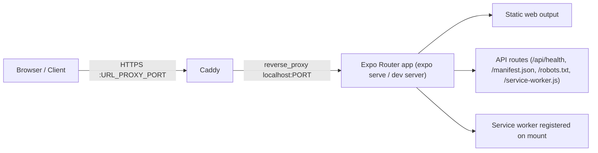
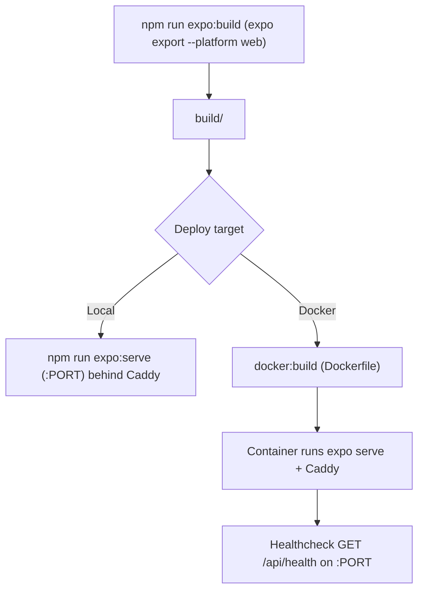

# Contributing

## Prerequisites
- Node.js/npm (Docker image uses Node 22)
- Docker + Compose for containerized runs
- `eas-cli` is invoked on demand via `npx` by the `eas:*` scripts (Expo Hosting); `gh` (GitHub CLI) remains a system tool, used by `npm run github:secrets` and `npm run github:deploy` (authenticated via the `GH_TOKEN` key in `.env`); Caddy is bundled in the Docker runtime, so for local Caddy commands use a local Caddy install

## Setup
1. `npm ci`
2. Ensure `.env` exists and is **POSIX-compatible** (simple `KEY=value` lines). Every consumer loads it natively — `set -a` sourcing in the expo scripts, Caddy's `--envfile`, Node's `--env-file` in `opencode.json`.
3. **`.env` is the single source of truth for project configuration.** Do not add fallback/default values elsewhere; all required configuration must be defined in `.env`.

## Development workflow
- App is **web-only** (Expo Router, Metro, static web output with API routes). Do not assume native platforms are configured.
- Edit source in `src/` and root config (`app.config.js`, `metro.config.js`, `tailwind.config.js`, etc.). Do not edit generated artifacts in `build/` or `node_modules/`.
- Dev server: `npm run expo:start` (requires `PORT` in `.env`). Tunnel: `npm run expo:start:tunnel`.
- Add convenience/repeatable project commands as scripts in `package.json`; do not create a `scripts/` directory for them. Treat `package.json` scripts as the single source of truth for how to run and configure the project.
- Keep `package.json` dependencies entries limited to what is actually imported/used in the entire project — source code (`src/`), root configs (`app.config.js`, `babel.config.js`, `metro.config.js`, `tailwind.config.js`, etc.), and packages referenced in `package.json` scripts (e.g. the `expo` CLI invoked by the `expo:*` scripts). Do not list unused dependencies. List explicitly imported packages even if they are also a dependency of another package.
- `devDependencies` holds workspace-local tooling that is not imported by the app.

## Guides

### Project structure (tree)

Show the canonical up-to-date tree from `README.md` → **Project structure**; keep trees in tree-like format when documenting or communicating structure. (Canonical snapshot lives there — do not duplicate it here so there's a single source of truth.)

### Diagrams & flowcharts (Mermaid)

Use **Mermaid** for diagrams/flowcharts in docs. Example: local dev/proxy runtime flow:

Example: build & deploy pipeline:

## Routing & API conventions (Expo Router)
- File-based routes live in `src/app/`.
- API/special web routes use `+api` suffix naming, e.g. `api/health+api.js` → `/api/health`, `robots.txt+api.js`, `manifest.json+api.js`, `service-worker.js+api.js`. Handlers receive web `Request` and return `Response`.
- Root layout is `src/app/_layout.js`; custom document shell is `src/app/+html.js`.

### Adding a page/route
1. Create `src/app/<route>.js` and `export default` the screen component (React Native Web primitives with NativeWind `className`).
2. If it should register in the navigator, nothing else needed — the Stack renders all file routes; use `+not-found.js` pattern for unmatched.
3. Add the route to the **Routes & endpoints** table in `README.md`.

### Adding an API route
1. Create `src/app/<path>+api.js` with `export function GET()` (and other HTTP verbs when needed), receiving web `Request` and returning `Response`.
2. Set a correct `Content-Type` and sensible cache semantics in headers (e.g. `Cache-Control: no-store` for probes like `/api/health`).
3. Add the endpoint to the **Routes & endpoints** table in `README.md` (and note any build/runtime coupling, e.g. Docker healthchecks).

## Styling & config
- Use NativeWind/Tailwind classes (`className`) with React Native Web primitives. Global CSS is `src/stylesheets/global.css` (imported in layout and wired via `withNativeWind` in `metro.config.js`).
- Tailwind content scans `src/**/*.{js,jsx,ts,tsx}`; dark mode is `class`-based.
- Client-visible config comes from `EXPO_PUBLIC_*` vars (see `src/shared/config.js`, `app.config.js`). Keep secrets out of `EXPO_PUBLIC_*`.

## Documentation conventions
- Always include JSDoc for modules with a top-level `@module` tag.
- Always add JSDoc for top-level exported functions and top-level exported variables for proper type documentation.
- Never include the `@example` tag in JSDoc.

## Verification
- No lint/test/typecheck scripts are configured; the only CI is the push-to-deploy Expo Hosting workflow (`.github/workflows/deploy.yml`, documented under `README.md` → Deployment) — it exports the web build on the GitHub runner and deploys only the artifact to EAS via `npm run eas:deploy`. Manually verify changes: `npm run expo:build` and/or `npm run expo:start` (and `npm run docker:build` if touching container/runtime config).
- `/api/health` returns `{ status: "ok", timestamp, uptime }` with `Cache-Control: no-store` (used by Docker healthcheck).

## Documentation maintenance
- Whenever possible, keep `README.md`, `CONTRIBUTING.md`, and `DESIGN.md` in sync with relevant changes (behavior, config, conventions, UI/tokens, workflows) — this mirrors the agent rule in `AGENTS.md`.
- Document structure in tree form and use **Mermaid** for diagrams (see **Guides** above).

## Commits & PRs
- Commit messages use one of these tagged types describing the change:
  - `(feature)` — newly added feature
  - `(chore)` — documentation/configuration maintenance
  - `(ui)` — UI/UX changes, anything that is UI-related
  - `(fix)` — bug and hot fixes
  - `(refactor)` — optimizations and code quality
- Format: a one-line short descriptive title after the tag, followed by a multi-line bulleted list of the individual changes. For example, a feature addition with three changes would read: the `(feature)` tag, the title, and then `-` bullets — one per change.
- Commit automatically as work completes: apply the tagged types and the message format above to every commit, at least one commit per cohesive change, without waiting for an explicit commit request. **Never push automatically** — pushing to the remote is always a deliberate, explicit action; deploys run through the push-to-deploy workflow (`README.md` → Deployment), and an explicit deployment push should use `npm run github:deploy` (refreshes the `DOT_ENV` secret first, then pushes `portfolio`).
- Keep changes focused; include manual verification steps in the list when relevant. Repository URL and default branch are listed in `README.md`.
